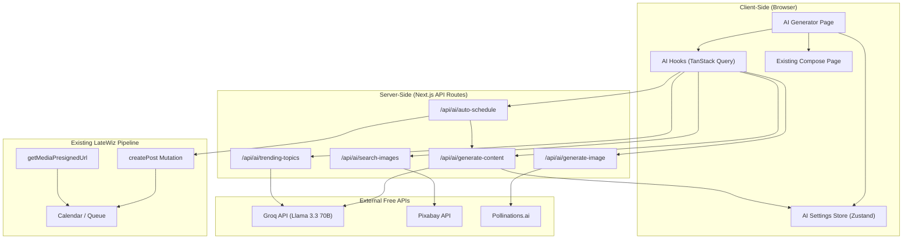
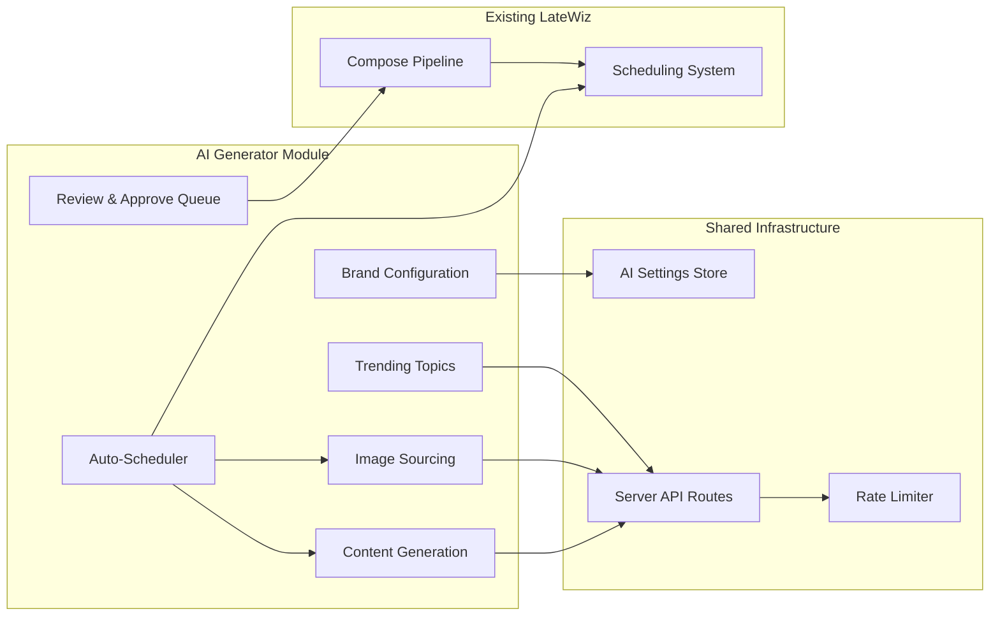
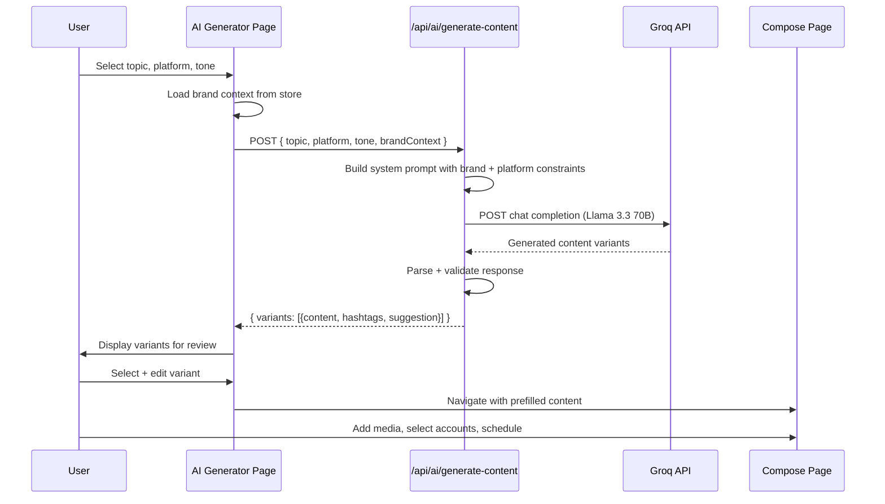
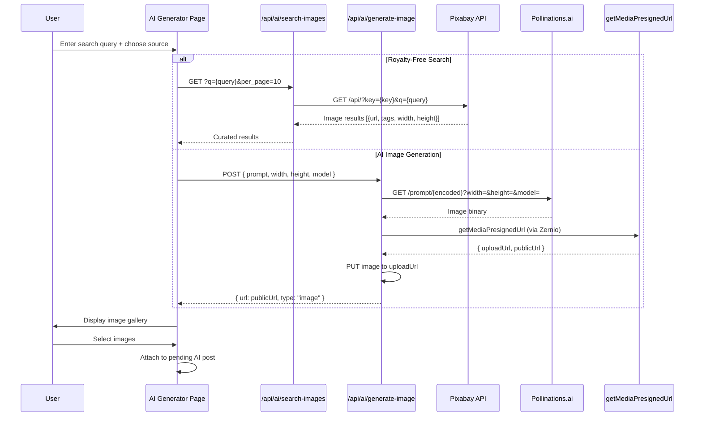
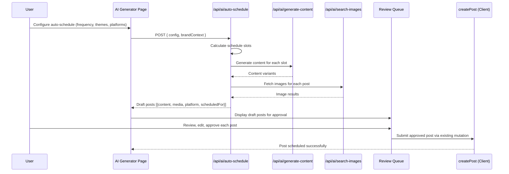
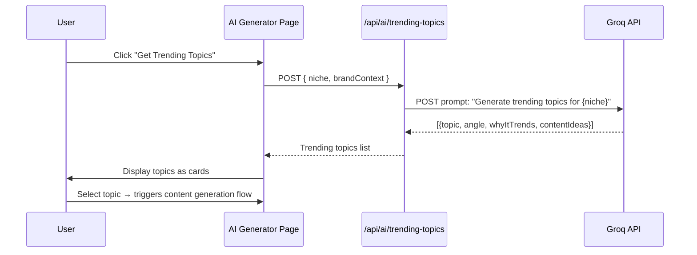

# Design Document: AI Content Generator

## Overview

The AI Content Generator is a new feature for LateWiz that enables users to automatically generate, curate, and schedule social media content using free AI services. The system leverages Groq's free LLM API for text generation, Pixabay's free API for royalty-free stock images, and Pollinations.ai's free URL-based service for AI-generated images. All external API calls are made server-side through Next.js API routes to keep API keys secure and never expose them to the client.

The feature integrates directly into LateWiz's existing compose and scheduling pipeline. AI-generated content flows through the same `createPost` mutation, `mediaItems` structure, and scheduling system that manual posts use. Users maintain full control through a review-and-edit step before any AI-generated post is published or scheduled. Brand guidelines, tone preferences, and target audience settings are stored client-side via Zustand and passed as context to the AI generation requests.

The design covers six core subsystems: AI text generation, royalty-free image sourcing, AI image generation, branding context management, trending topic integration, and auto-scheduling with user approval. Each subsystem is designed as an independent, composable module that can be extended or swapped (e.g., Groq can be replaced with Gemini as a fallback) without affecting the others.

## Architecture

The AI Content Generator follows a server-side-first architecture where all external API calls (Groq, Pixabay, Pollinations) happen in Next.js API route handlers. The client-side manages UI state, user preferences, and orchestrates calls to these server routes. Generated content is funneled through the existing compose pipeline.



### Component Architecture



## Sequence Diagrams

### Content Generation Flow



### Image Sourcing Flow (Royalty-Free + AI-Generated)



### Auto-Scheduling Flow



### Trending Topics Flow



## Components and Interfaces

### Component 1: AI Settings Store (Zustand)

**Purpose**: Stores brand configuration, AI preferences, and generation history on the client side. Persisted to localStorage.

```typescript
interface AISettingsState {
  // Brand configuration
  brandProfile: BrandProfile;
  // AI generation preferences
  generationPrefs: GenerationPrefs;
  // Auto-schedule configuration
  autoScheduleConfig: AutoScheduleConfig;
  // Generation history (last 50)
  generationHistory: GeneratedPostDraft[];
  // Actions
  setBrandProfile: (profile: Partial<BrandProfile>) => void;
  setGenerationPrefs: (prefs: Partial<GenerationPrefs>) => void;
  setAutoScheduleConfig: (config: Partial<AutoScheduleConfig>) => void;
  addGenerationHistory: (draft: GeneratedPostDraft) => void;
  clearGenerationHistory: () => void;
}
```

**Responsibilities**:
- Store and persist brand guidelines (tone, voice, target audience, hashtags, do/don't lists)
- Store generation preferences (default model, temperature, max tokens)
- Store auto-schedule configuration (frequency, posting times, content themes)
- Track generation history for user reference
- Persist to localStorage via Zustand `persist` middleware

### Component 2: Server API Routes

**Purpose**: Proxy all external API calls server-side, keeping API keys in environment variables and never exposing them to the client.

```typescript
// POST /api/ai/generate-content
interface GenerateContentRequest {
  topic: string;
  platform: Platform;
  tone?: string;
  brandContext: BrandProfile;
  contentAngle?: string;
  numVariants?: number; // default 3
}

interface GenerateContentResponse {
  variants: ContentVariant[];
}

interface ContentVariant {
  id: string;
  content: string;
  hashtags: string[];
  imageSuggestion: string;
  callToAction?: string;
  platformSpecificData?: PlatformSpecificData;
}

// GET /api/ai/search-images?q={query}&per_page={n}&image_type={type}
interface SearchImagesResponse {
  images: StockImage[];
  total: number;
}

interface StockImage {
  id: string;
  url: string;
  previewUrl: string;
  tags: string[];
  width: number;
  height: number;
  source: "pixabay";
}

// POST /api/ai/generate-image
interface GenerateImageRequest {
  prompt: string;
  width?: number; // default 1024
  height?: number; // default 1024
  model?: "flux" | "turbo"; // default "flux"
}

interface GenerateImageResponse {
  url: string;
  type: "image";
  width: number;
  height: number;
}

// POST /api/ai/trending-topics
interface TrendingTopicsRequest {
  niche: string;
  brandContext?: BrandProfile;
}

interface TrendingTopicsResponse {
  topics: TrendingTopic[];
}

interface TrendingTopic {
  id: string;
  topic: string;
  angle: string;
  whyItTrends: string;
  contentIdeas: string[];
}

// POST /api/ai/auto-schedule
interface AutoScheduleRequest {
  config: AutoScheduleConfig;
  brandContext: BrandProfile;
  platforms: PlatformPost[];
  timezone: string;
}

interface AutoScheduleResponse {
  draftPosts: DraftScheduledPost[];
}

interface DraftScheduledPost {
  id: string;
  content: string;
  hashtags: string[];
  mediaUrls: MediaItem[];
  platforms: PlatformPost[];
  scheduledFor: string; // ISO string
  topic: string;
  status: "draft"; // always draft for user review
}
```

**Responsibilities**:
- Proxy all external API calls with server-side API keys
- Apply rate limiting to respect free-tier limits
- Validate and sanitize all inputs
- Parse and normalize external API responses
- Handle fallback providers (Groq → Gemini, Pixabay → Unsplash)
- For AI image generation: download from Pollinations, re-upload via Zernio presigned URL system

### Component 3: AI Hooks (TanStack Query)

**Purpose**: Client-side data fetching and mutation hooks for all AI operations.

```typescript
// Query hooks
function useGenerateContent(): UseMutationResult<GenerateContentResponse, Error, GenerateContentRequest>;
function useSearchImages(): UseMutationResult<SearchImagesResponse, Error, { query: string; perPage: number }>;
function useGenerateImage(): UseMutationResult<GenerateImageResponse, Error, GenerateImageRequest>;
function useTrendingTopics(): UseMutationResult<TrendingTopicsResponse, Error, TrendingTopicsRequest>;
function useAutoSchedule(): UseMutationResult<AutoScheduleResponse, Error, AutoScheduleRequest>;
```

**Responsibilities**:
- Wrap server API route calls in TanStack Query mutations
- Handle loading/error states
- Cache responses where appropriate (e.g., trending topics cached for 1 hour)
- Provide retry logic for transient failures
- Invalidate relevant queries on success

### Component 4: AI Generator Page

**Purpose**: Main UI for the AI content generation workflow.

```typescript
interface AIGeneratorPageProps {
  // No props - uses hooks and stores
}

// Sub-components
interface BrandConfigPanelProps {
  brandProfile: BrandProfile;
  onSave: (profile: BrandProfile) => void;
}

interface ContentGenerationPanelProps {
  onGenerate: (request: GenerateContentRequest) => void;
  variants: ContentVariant[];
  onSelectVariant: (variant: ContentVariant) => void;
  isLoading: boolean;
}

interface ImageGalleryProps {
  images: StockImage[];
  aiImageLoading: boolean;
  onSelectImage: (image: StockImage | { url: string; type: "image" }) => void;
  searchQuery: string;
  onSearch: (query: string) => void;
  onGenerateAI: (prompt: string) => void;
}

interface TrendingTopicsPanelProps {
  topics: TrendingTopic[];
  onSelectTopic: (topic: TrendingTopic) => void;
  isLoading: boolean;
}

interface ReviewQueuePanelProps {
  drafts: DraftScheduledPost[];
  onApprove: (draft: DraftScheduledPost) => void;
  onEdit: (draft: DraftScheduledPost) => void;
  onDiscard: (draftId: string) => void;
}
```

**Responsibilities**:
- Provide a multi-step workflow UI: configure brand → generate content → select images → review → schedule
- Show real-time loading states during AI generation
- Allow inline editing of generated content before scheduling
- Display platform-specific previews using existing `PlatformPreviews` component
- Support both manual single-post generation and auto-scheduling batch mode

## Data Models

### BrandProfile

```typescript
interface BrandProfile {
  brandName: string;
  description: string;
  tone: string; // e.g., "professional", "casual", "witty", "inspirational"
  voice: string; // e.g., "expert but approachable"
  targetAudience: string; // e.g., "small business owners, age 25-45"
  industry: string; // e.g., "SaaS", "fashion", "fitness"
  hashtags: string[]; // brand hashtags to always include
  doList: string[]; // what the brand should do
  dontList: string[]; // what the brand should avoid
  defaultCTA: string; // default call-to-action
}
```

**Validation Rules**:
- `brandName`: required, non-empty, max 100 characters
- `tone`: required, must be from predefined list or custom string, max 50 characters
- `hashtags`: each tag must start with `#`, max 30 tags
- `doList` / `dontList`: max 10 items each, max 200 characters per item
- All text fields are sanitized to prevent prompt injection

### GenerationPrefs

```typescript
interface GenerationPrefs {
  defaultModel: "llama-3.3-70b" | "llama-3.1-8b";
  temperature: number; // 0.0 - 1.0, default 0.7
  maxTokens: number; // default 1024
  numVariants: number; // 1-5, default 3
  includeHashtags: boolean; // default true
  includeEmoji: boolean; // default true
  includeCTA: boolean; // default true
}
```

**Validation Rules**:
- `temperature`: must be between 0.0 and 1.0 inclusive
- `maxTokens`: must be between 256 and 4096
- `numVariants`: must be between 1 and 5
- `defaultModel`: must be a valid Groq model identifier

### AutoScheduleConfig

```typescript
interface AutoScheduleConfig {
  enabled: boolean;
  frequency: "daily" | "every-other-day" | "weekly" | "custom";
  postsPerWeek: number; // 1-14
  postingTimes: string[]; // ["09:00", "13:00", "17:00"] in user timezone
  contentThemes: ContentTheme[];
  startDate: string; // ISO date string
  endDate?: string; // optional, ISO date string
}

interface ContentTheme {
  id: string;
  name: string; // e.g., "Educational Tips", "Industry News", "Behind the Scenes"
  description: string;
  weight: number; // 0.0-1.0, relative frequency
}
```

**Validation Rules**:
- `postsPerWeek`: 1-14
- `postingTimes`: each must be valid "HH:MM" format, max 7 entries
- `contentThemes`: at least 1 required if auto-scheduling enabled
- `weight` values: must sum to 1.0 across all themes
- `startDate`: must be today or future
- `endDate`: if provided, must be after `startDate`

### GeneratedPostDraft

```typescript
interface GeneratedPostDraft {
  id: string; // UUID
  content: string;
  hashtags: string[];
  mediaItems: MediaItem[];
  platforms: PlatformPost[];
  topic: string;
  source: "manual" | "auto-schedule" | "trending";
  generatedAt: string; // ISO timestamp
  status: "draft" | "approved" | "scheduled" | "discarded";
  scheduledFor?: string; // ISO timestamp, set when approved + scheduled
  brandSnapshot: BrandProfile; // snapshot of brand context used
}
```

**Validation Rules**:
- `content`: max 280 characters for Twitter, 2200 for Instagram, platform-dependent
- `mediaItems`: must conform to existing `MediaItem` type from `use-posts.ts`
- `platforms`: must conform to existing `PlatformPost` type from `use-posts.ts`
- `status`: transitions only: draft → approved → scheduled, draft → discarded

### ContentVariant

```typescript
interface ContentVariant {
  id: string;
  content: string;
  hashtags: string[];
  imageSuggestion: string; // description of ideal image
  callToAction?: string;
  platformSpecificData?: PlatformSpecificData;
  characterCount: number;
  platformValid: boolean; // true if within platform char limits
  warnings: string[]; // e.g., "Hashtags exceed limit for Twitter"
}
```

**Validation Rules**:
- `content`: non-empty, max 5000 characters
- `characterCount`: must equal `content.length`
- `platformValid`: must be false if `characterCount` exceeds platform limit
- `warnings`: populated with constraint violations

## Algorithmic Pseudocode

### Content Generation Algorithm

```pascal
ALGORITHM generateContent(request, groqClient)
INPUT: request of type GenerateContentRequest
INPUT: groqClient of type GroqClient
OUTPUT: response of type GenerateContentResponse

PRECONDITIONS:
  - request.topic is non-empty string
  - request.platform is a valid Platform enum value
  - request.brandContext is a valid BrandProfile
  - GROQ_API_KEY environment variable is set

BEGIN
  // Step 1: Build system prompt with brand context
  systemPrompt ← buildSystemPrompt(request.brandContext, request.platform)
  
  // Step 2: Build user prompt with topic and constraints
  constraints ← getPlatformConstraints(request.platform)
  userPrompt ← buildUserPrompt(request.topic, request.tone, constraints, request.numVariants)
  
  // Step 3: Call Groq API
  ASSERT isValidPrompt(systemPrompt) AND isValidPrompt(userPrompt)
  
  groqResponse ← groqClient.chatCompletion({
    model: request.model OR "llama-3.3-70b",
    messages: [
      { role: "system", content: systemPrompt },
      { role: "user", content: userPrompt }
    ],
    temperature: request.temperature OR 0.7,
    max_tokens: request.maxTokens OR 1024
  })
  
  // Step 4: Parse JSON response
  ASSERT groqResponse.choices[0].message.content is non-empty
  
  parsedContent ← parseJSON(groqResponse.choices[0].message.content)
  
  IF parseFailed THEN
    parsedContent ← extractContentFallback(groqResponse.choices[0].message.content)
  END IF
  
  // Step 5: Validate and build variants
  variants ← []
  FOR each item IN parsedContent.variants DO
    ASSERT item.content is non-empty string
    
    variant ← {
      id: generateUUID(),
      content: item.content,
      hashtags: validateHashtags(item.hashtags, request.platform),
      imageSuggestion: item.imageSuggestion OR "",
      callToAction: item.callToAction OR request.brandContext.defaultCTA,
      characterCount: length(item.content),
      platformValid: checkPlatformLimits(item.content, request.platform),
      warnings: generateWarnings(item, request.platform)
    }
    
    variants.add(variant)
  END FOR
  
  // Step 6: Ensure at least one valid variant
  ASSERT variants.length > 0
  
  RETURN { variants: variants }
END

POSTCONDITIONS:
  - response.variants is non-empty array
  - Each variant has unique id
  - Each variant.content is non-empty string
  - Each variant.characterCount equals length of content
  - platformValid is true if and only if content is within platform limits
  - No API keys are included in the response
```

### Image Search Algorithm (Pixabay)

```pascal
ALGORITHM searchImages(query, perPage, pixabayApiKey)
INPUT: query of type string
INPUT: perPage of type integer (1-200)
INPUT: pixabayApiKey of type string
OUTPUT: response of type SearchImagesResponse

PRECONDITIONS:
  - query is non-empty string, max 100 characters
  - perPage is between 1 and 200
  - PIXABAY_API_KEY environment variable is set

BEGIN
  // Step 1: Sanitize query
  sanitizedQuery ← URLencode(query)
  ASSERT sanitizedQuery does not contain control characters
  
  // Step 2: Build Pixabay API URL
  apiUrl ← "https://pixabay.com/api/?key=" + pixabayApiKey
  apiUrl ← apiUrl + "&q=" + sanitizedQuery
  apiUrl ← apiUrl + "&per_page=" + toString(perPage)
  apiUrl ← apiUrl + "&image_type=photo"
  apiUrl ← apiUrl + "&safesearch=true"
  apiUrl ← apiUrl + "&orientation=horizontal"
  
  // Step 3: Call Pixabay API
  pixabayResponse ← HTTP_GET(apiUrl)
  
  IF pixabayResponse.status != 200 THEN
    THROW PixabayError(pixabayResponse.status)
  END IF
  
  // Step 4: Parse and normalize results
  images ← []
  FOR each hit IN pixabayResponse.hits DO
    ASSERT hit.webformatURL is non-empty string
    
    image ← {
      id: toString(hit.id),
      url: hit.webformatURL,
      previewUrl: hit.previewURL,
      tags: split(hit.tags, ","),
      width: hit.imageWidth,
      height: hit.imageHeight,
      source: "pixabay"
    }
    
    images.add(image)
  END FOR
  
  RETURN { images: images, total: pixabayResponse.totalHits }
END

POSTCONDITIONS:
  - response.images contains at most perPage items
  - Each image has valid url and previewUrl
  - All images have source = "pixabay"
  - No API keys are included in image objects or response
```

### AI Image Generation Algorithm (Pollinations)

```pascal
ALGORITHM generateAIImage(request, lateMediaClient)
INPUT: request of type GenerateImageRequest
INPUT: lateMediaClient of type Late (Zernio client)
OUTPUT: response of type GenerateImageResponse

PRECONDITIONS:
  - request.prompt is non-empty string, max 500 characters
  - request.width is between 256 and 2048 (default 1024)
  - request.height is between 256 and 2048 (default 1024)
  - request.model is "flux" or "turbo" (default "flux")

BEGIN
  // Step 1: Encode prompt for URL
  encodedPrompt ← URLencode(request.prompt)
  ASSERT encodedPrompt is valid URL component
  
  // Step 2: Build Pollinations URL
  pollinationsUrl ← "https://image.pollinations.ai/prompt/"
  pollinationsUrl ← pollinationsUrl + encodedPrompt
  pollinationsUrl ← pollinationsUrl + "?width=" + toString(request.width)
  pollinationsUrl ← pollinationsUrl + "&height=" + toString(request.height)
  pollinationsUrl ← pollinationsUrl + "&model=" + request.model
  pollinationsUrl ← pollinationsUrl + "&nologo=true"
  
  // Step 3: Fetch image binary from Pollinations
  imageResponse ← HTTP_GET(pollinationsUrl, { timeout: 60000 })
  
  IF imageResponse.status != 200 THEN
    THROW PollinationsError(imageResponse.status)
  END IF
  
  imageBlob ← imageResponse.body  // binary image data
  ASSERT imageBlob is non-empty
  ASSERT imageBlob.type starts with "image/"
  
  // Step 4: Get presigned upload URL from Zernio
  filename ← "ai-generated-" + timestamp() + ".jpg"
  presignResult ← lateMediaClient.media.getMediaPresignedUrl({
    body: { filename: filename, contentType: "image/jpeg" }
  })
  
  ASSERT presignResult.uploadUrl is non-empty
  ASSERT presignResult.publicUrl is non-empty
  
  // Step 5: Upload image to Zernio storage via presigned URL
  uploadResponse ← HTTP_PUT(presignResult.uploadUrl, imageBlob, {
    headers: { "Content-Type": "image/jpeg" }
  })
  
  IF uploadResponse.status != 200 THEN
    THROW UploadError(uploadResponse.status)
  END IF
  
  // Step 6: Return public URL
  RETURN {
    url: presignResult.publicUrl,
    type: "image",
    width: request.width,
    height: request.height
  }
END

POSTCONDITIONS:
  - response.url is a valid public URL accessible by Zernio
  - response.type is "image"
  - The image at response.url matches the generated image
  - No API keys are included in the response
  - The Pollinations.ai URL is not exposed to the client
```

### Auto-Scheduling Algorithm

```pascal
ALGORITHM autoSchedule(config, brandContext, platforms, timezone, contentGenFn)
INPUT: config of type AutoScheduleConfig
INPUT: brandContext of type BrandProfile
INPUT: platforms of type PlatformPost[]
INPUT: timezone of type string
INPUT: contentGenFn of type Function (generates content)
OUTPUT: response of type AutoScheduleResponse

PRECONDITIONS:
  - config.enabled is true
  - config.postsPerWeek is between 1 and 14
  - config.postingTimes is non-empty array of "HH:MM" strings
  - config.contentThemes is non-empty array
  - Sum of all config.contentThemes[].weight equals 1.0
  - platforms is non-empty array
  - timezone is a valid IANA timezone string

BEGIN
  // Step 1: Calculate schedule slots
  scheduleSlots ← []
  currentDate ← config.startDate
  
  totalSlots ← config.postsPerWeek * weeksBetween(config.startDate, config.endDate OR config.startDate + 30 days)
  
  FOR i FROM 0 TO totalSlots - 1 DO
    ASSERT currentDate >= config.startDate
    
    // Determine theme for this slot using weighted distribution
    theme ← selectWeightedTheme(config.contentThemes, i)
    
    // Determine posting time (cycle through postingTimes)
    timeIndex ← i MOD config.postingTimes.length
    slotTime ← config.postingTimes[timeIndex]
    
    // Build datetime in user timezone
    scheduledDateTime ← combineDateAndTime(currentDate, slotTime, timezone)
    scheduleSlots.add({ date: scheduledDateTime, theme: theme })
    
    // Advance date based on frequency
    IF config.frequency = "daily" THEN
      currentDate ← currentDate + 1 day
    ELSE IF config.frequency = "every-other-day" THEN
      currentDate ← currentDate + 2 days
    ELSE IF config.frequency = "weekly" THEN
      currentDate ← nextWeekday(currentDate, config.postingDays)
    ELSE
      currentDate ← currentDate + ceil(7 / config.postsPerWeek) days
    END IF
  END FOR
  
  // Step 2: Generate content for each slot
  draftPosts ← []
  FOR each slot IN scheduleSlots DO
    ASSERT slot.theme is a valid ContentTheme
    
    // Generate content for this slot's theme and platform
    contentRequest ← {
      topic: slot.theme.name + ": " + slot.theme.description,
      platform: platforms[0].platform,
      tone: brandContext.tone,
      brandContext: brandContext,
      numVariants: 1
    }
    
    contentResponse ← contentGenFn(contentRequest)
    ASSERT contentResponse.variants.length > 0
    
    selectedVariant ← contentResponse.variants[0]
    
    // Search for images based on variant's image suggestion
    imageSearchResponse ← searchImages(selectedVariant.imageSuggestion, 1)
    
    mediaItems ← []
    IF imageSearchResponse.images.length > 0 THEN
      mediaItems.add({ type: "image", url: imageSearchResponse.images[0].url })
    END IF
    
    draftPost ← {
      id: generateUUID(),
      content: selectedVariant.content,
      hashtags: selectedVariant.hashtags,
      mediaItems: mediaItems,
      platforms: platforms,
      scheduledFor: slot.date.toISOString(),
      topic: slot.theme.name,
      status: "draft",
      brandSnapshot: deepCopy(brandContext)
    }
    
    draftPosts.add(draftPost)
  END FOR
  
  // Step 3: Validate all drafts
  FOR each draft IN draftPosts DO
    ASSERT draft.content is non-empty
    ASSERT draft.scheduledFor is valid ISO string
    ASSERT draft.status = "draft"
  END FOR
  
  RETURN { draftPosts: draftPosts }
END

POSTCONDITIONS:
  - response.draftPosts is non-empty array
  - Every draft has status = "draft" (never auto-published)
  - Every draft has a valid scheduledFor timestamp in the future
  - Every draft.content is non-empty
  - Draft count equals totalSlots
  - No draft is published without user approval

LOOP INVARIANTS (schedule slot calculation):
  - currentDate is always >= config.startDate
  - scheduleSlots length <= totalSlots
  - Every slot has a valid theme from config.contentThemes
  - Every slot has a time from config.postingTimes

LOOP INVARIANTS (content generation):
  - draftPosts length <= scheduleSlots length
  - Every draft corresponds to exactly one schedule slot
  - Every draft has status = "draft"
```

### Trending Topics Algorithm

```pascal
ALGORITHM getTrendingTopics(request, groqClient)
INPUT: request of type TrendingTopicsRequest
INPUT: groqClient of type GroqClient
OUTPUT: response of type TrendingTopicsResponse

PRECONDITIONS:
  - request.niche is non-empty string, max 200 characters
  - GROQ_API_KEY environment variable is set

BEGIN
  // Step 1: Build prompt for trending topic generation
  systemPrompt ← "You are a social media trend analyst. "
  systemPrompt ← systemPrompt + "Generate trending content topics for the given niche. "
  systemPrompt ← systemPrompt + "Return JSON array of 10 topics."
  
  userPrompt ← "Niche: " + request.niche
  IF request.brandContext exists THEN
    userPrompt ← userPrompt + "\nBrand: " + request.brandContext.brandName
    userPrompt ← userPrompt + "\nAudience: " + request.brandContext.targetAudience
    userPrompt ← userPrompt + "\nIndustry: " + request.brandContext.industry
  END IF
  userPrompt ← userPrompt + "\n\nReturn JSON: [{topic, angle, whyItTrends, contentIdeas: []}]"
  
  // Step 2: Call Groq
  groqResponse ← groqClient.chatCompletion({
    model: "llama-3.3-70b",
    messages: [
      { role: "system", content: systemPrompt },
      { role: "user", content: userPrompt }
    ],
    temperature: 0.8,
    max_tokens: 2048
  })
  
  // Step 3: Parse response
  parsed ← parseJSON(groqResponse.choices[0].message.content)
  
  IF parseFailed THEN
    parsed ← extractTopicsFallback(groqResponse.choices[0].message.content)
  END IF
  
  // Step 4: Build topics with IDs
  topics ← []
  FOR each item IN parsed DO
    ASSERT item.topic is non-empty string
    
    topic ← {
      id: generateUUID(),
      topic: item.topic,
      angle: item.angle OR "",
      whyItTrends: item.whyItrends OR "",
      contentIdeas: item.contentIdeas OR []
    }
    
    topics.add(topic)
  END FOR
  
  RETURN { topics: topics }
END

POSTCONDITIONS:
  - response.topics is non-empty array (at least 1 topic)
  - Each topic has unique id
  - Each topic.topic is non-empty string
  - No API keys are included in the response
```

### Rate Limiting Algorithm

```pascal
ALGORITHM checkRateLimit(provider, identifier)
INPUT: provider of type "groq" | "pixabay" | "pollinations"
INPUT: identifier of type string (IP address or session ID)
OUTPUT: allowed of type boolean

PRECONDITIONS:
  - provider is a valid provider name
  - identifier is non-empty string

BEGIN
  // Get rate limits per provider
  limits ← {
    groq: { requests: 30, windowSeconds: 60 },
    pixabay: { requests: 100, windowSeconds: 60 },
    pollinations: { requests: 10, windowSeconds: 60 }
  }
  
  limit ← limits[provider]
  
  // Get current request count for this provider + identifier in the window
  key ← "ratelimit:" + provider + ":" + identifier
  count ← getFromCache(key)
  
  IF count is null THEN
    // First request in window
    setInCache(key, 1, limit.windowSeconds)
    RETURN true
  END IF
  
  IF count >= limit.requests THEN
    RETURN false
  END IF
  
  // Increment count
  incrementInCache(key)
  RETURN true
END

POSTCONDITIONS:
  - Returns true if request is within rate limit
  - Returns false if rate limit exceeded
  - Cache key is properly namespaced by provider
```

## Key Functions with Formal Specifications

### Function: buildSystemPrompt()

```typescript
function buildSystemPrompt(brand: BrandProfile, platform: Platform): string
```

**Preconditions:**
- `brand` is non-null and has all required fields populated
- `platform` is a valid Platform enum value

**Postconditions:**
- Returns non-empty string
- String includes brand name, tone, voice, target audience, and platform constraints
- String does not contain any user-provided content without sanitization
- String length does not exceed 4000 characters

### Function: buildUserPrompt()

```typescript
function buildUserPrompt(
  topic: string,
  tone: string | undefined,
  constraints: PlatformConstraints,
  numVariants: number
): string
```

**Preconditions:**
- `topic` is non-empty string, max 500 characters
- `constraints` is a valid PlatformConstraints object
- `numVariants` is between 1 and 5

**Postconditions:**
- Returns non-empty string
- String includes topic, optional tone override, platform constraints, and variant count
- String includes JSON output format instructions
- String length does not exceed 2000 characters

### Function: checkPlatformLimits()

```typescript
function checkPlatformLimits(content: string, platform: Platform): boolean
```

**Preconditions:**
- `content` is a string (may be empty)
- `platform` is a valid Platform enum value

**Postconditions:**
- Returns `true` if content length is within platform-specific character limit
- Returns `false` if content exceeds platform limit
- No mutations to input parameters
- Character limits: twitter=280, instagram=2200, linkedin=3000, facebook=63206, others=5000

### Function: validateHashtags()

```typescript
function validateHashtags(hashtags: string[], platform: Platform): string[]
```

**Preconditions:**
- `hashtags` is an array of strings
- `platform` is a valid Platform enum value

**Postconditions:**
- Returns array of strings, each starting with `#`
- Tags exceeding platform-specific limits are truncated
- Empty tags are removed
- No mutations to input array
- Max tags: twitter=2, instagram=30, linkedin=5, facebook=10, others=10

### Function: selectWeightedTheme()

```typescript
function selectWeightedTheme(themes: ContentTheme[], index: number): ContentTheme
```

**Preconditions:**
- `themes` is a non-empty array of ContentTheme objects
- Sum of all `themes[].weight` equals 1.0
- `index` is a non-negative integer

**Postconditions:**
- Returns a ContentTheme from the input array
- Selection follows weighted distribution: theme with weight 0.5 selected ~50% of the time
- No mutations to input array

### Function: parseJSON()

```typescript
function parseJSON(content: string): ParsedAIResponse | null
```

**Preconditions:**
- `content` is a string (may be empty or malformed)

**Postconditions:**
- Returns parsed object if content contains valid JSON
- Returns null if content does not contain parseable JSON
- Extracts JSON from markdown code blocks if present
- No side effects

### Function: extractContentFallback()

```typescript
function extractContentFallback(content: string): { variants: ContentVariant[] }
```

**Preconditions:**
- `content` is a non-empty string that failed JSON parsing

**Postconditions:**
- Returns object with at least one variant
- Variant content is extracted from the raw text
- Hashtags are extracted from lines starting with `#`
- No API keys or sensitive data in the response

## Example Usage

### Example 1: Single Post Generation

```typescript
// In a React component
import { useGenerateContent } from "@/hooks/use-ai";
import { useAISettingsStore } from "@/stores/ai-settings-store";

function ContentGenerationExample() {
  const generateContent = useGenerateContent();
  const { brandProfile } = useAISettingsStore();

  const handleGenerate = async () => {
    const response = await generateContent.mutateAsync({
      topic: "5 productivity tips for remote workers",
      platform: "linkedin",
      tone: "professional",
      brandContext: brandProfile,
      numVariants: 3,
    });

    // response.variants contains 3 content options
    response.variants.forEach((variant) => {
      console.log(variant.content);
      console.log(variant.hashtags);
      console.log(variant.imageSuggestion);
    });
  };

  return (
    <Button onClick={handleGenerate} loading={generateContent.isPending}>
      Generate Content
    </Button>
  );
}
```

### Example 2: Image Search (Royalty-Free)

```typescript
import { useSearchImages } from "@/hooks/use-ai";

function ImageSearchExample() {
  const searchImages = useSearchImages();

  const handleSearch = async (query: string) => {
    const response = await searchImages.mutateAsync({
      query: "remote work productivity",
      perPage: 10,
    });

    // response.images contains Pixabay results
    response.images.forEach((img) => {
      console.log(img.url, img.previewUrl, img.tags);
    });
  };
}
```

### Example 3: AI Image Generation

```typescript
import { useGenerateImage } from "@/hooks/use-ai";

function AIImageExample() {
  const generateImage = useGenerateImage();

  const handleGenerate = async () => {
    const response = await generateImage.mutateAsync({
      prompt: "A modern desk setup with laptop, coffee, and plants in soft natural lighting",
      width: 1024,
      height: 1024,
      model: "flux",
    });

    // response.url is a Zernio-hosted public URL
    // Can be used directly in MediaItem array for createPost
    console.log(response.url);
  };
}
```

### Example 4: Full Workflow (Generate → Select Images → Schedule)

```typescript
import { useGenerateContent, useSearchImages, useGenerateImage } from "@/hooks/use-ai";
import { useCreatePost } from "@/hooks/use-posts";
import { useAISettingsStore } from "@/stores/ai-settings-store";

function FullWorkflowExample() {
  const generateContent = useGenerateContent();
  const searchImages = useSearchImages();
  const generateImage = useGenerateImage();
  const createPost = useCreatePost();
  const { brandProfile } = useAISettingsStore();

  const runFullWorkflow = async (
    topic: string,
    platform: Platform,
    accountId: string,
    scheduledFor: string | undefined
  ) => {
    // Step 1: Generate content
    const contentResponse = await generateContent.mutateAsync({
      topic,
      platform,
      brandContext: brandProfile,
      numVariants: 1,
    });
    const variant = contentResponse.variants[0];

    // Step 2: Search for stock images
    const imageResponse = await searchImages.mutateAsync({
      query: variant.imageSuggestion,
      perPage: 1,
    });

    let mediaItems: MediaItem[] = [];
    if (imageResponse.images.length > 0) {
      mediaItems = [{
        type: "image",
        url: imageResponse.images[0].url,
      }];
    }

    // Step 3: Create post via existing pipeline
    await createPost.mutateAsync({
      content: variant.content,
      mediaItems: mediaItems.length > 0 ? mediaItems : undefined,
      platforms: [{ platform, accountId }],
      scheduledFor,
      publishNow: !scheduledFor,
      timezone: Intl.DateTimeFormat().resolvedOptions().timeZone,
    });
  };
}
```

### Example 5: Auto-Schedule Configuration

```typescript
import { useAutoSchedule } from "@/hooks/use-ai";
import { useAISettingsStore } from "@/stores/ai-settings-store";

function AutoScheduleExample() {
  const autoSchedule = useAutoSchedule();
  const { brandProfile, autoScheduleConfig } = useAISettingsStore();

  const handleAutoSchedule = async (
    platforms: PlatformPost[],
    timezone: string
  ) => {
    const response = await autoSchedule.mutateAsync({
      config: autoScheduleConfig,
      brandContext: brandProfile,
      platforms,
      timezone,
    });

    // response.draftPosts contains posts for user review
    // Each draft has status = "draft" - never auto-published
    response.draftPosts.forEach((draft) => {
      console.log(draft.topic, draft.scheduledFor, draft.content);
    });
  };
}
```

### Example 6: Server-Side API Route (generate-content)

```typescript
// /api/ai/generate-content/route.ts
import { NextRequest, NextResponse } from "next/server";

export async function POST(request: NextRequest) {
  const body = await request.json() as GenerateContentRequest;

  // Validate input
  if (!body.topic || typeof body.topic !== "string") {
    return NextResponse.json(
      { error: "Topic is required" },
      { status: 400 }
    );
  }

  // Check rate limit
  const identifier = request.headers.get("x-forwarded-for") || "anonymous";
  if (!checkRateLimit("groq", identifier)) {
    return NextResponse.json(
      { error: "Rate limit exceeded. Try again in a minute." },
      { status: 429 }
    );
  }

  // Build prompts
  const systemPrompt = buildSystemPrompt(body.brandContext, body.platform);
  const userPrompt = buildUserPrompt(
    body.topic,
    body.tone,
    getPlatformConstraints(body.platform),
    body.numVariants || 3
  );

  // Call Groq API
  const groqResponse = await fetch("https://api.groq.com/openai/v1/chat/completions", {
    method: "POST",
    headers: {
      "Authorization": `Bearer ${process.env.GROQ_API_KEY}`,
      "Content-Type": "application/json",
    },
    body: JSON.stringify({
      model: "llama-3.3-70b-versatile",
      messages: [
        { role: "system", content: systemPrompt },
        { role: "user", content: userPrompt },
      ],
      temperature: 0.7,
      max_tokens: 1024,
    }),
  });

  if (!groqResponse.ok) {
    return NextResponse.json(
      { error: "AI generation failed" },
      { status: 502 }
    );
  }

  const groqData = await groqResponse.json();
  const content = groqData.choices[0].message.content;
  const parsed = parseJSON(content) || extractContentFallback(content);

  // Validate and build variants
  const variants = parsed.variants.map((v) => ({
    id: crypto.randomUUID(),
    content: v.content,
    hashtags: validateHashtags(v.hashtags, body.platform),
    imageSuggestion: v.imageSuggestion || "",
    callToAction: v.callToAction,
    characterCount: v.content.length,
    platformValid: checkPlatformLimits(v.content, body.platform),
    warnings: generateWarnings(v, body.platform),
  }));

  return NextResponse.json({ variants });
}
```

### Example 7: Server-Side API Route (generate-image with Pollinations + Zernio upload)

```typescript
// /api/ai/generate-image/route.ts
import { NextRequest, NextResponse } from "next/server";
import { getServerClient } from "@/lib/late-api/client";

export async function POST(request: NextRequest) {
  const body = await request.json() as GenerateImageRequest;

  // Validate input
  if (!body.prompt || typeof body.prompt !== "string") {
    return NextResponse.json(
      { error: "Prompt is required" },
      { status: 400 }
    );
  }

  const width = body.width || 1024;
  const height = body.height || 1024;
  const model = body.model || "flux";

  // Check rate limit
  const identifier = request.headers.get("x-forwarded-for") || "anonymous";
  if (!checkRateLimit("pollinations", identifier)) {
    return NextResponse.json(
      { error: "Rate limit exceeded. Try again in a minute." },
      { status: 429 }
    );
  }

  // Fetch image from Pollinations
  const encodedPrompt = encodeURIComponent(body.prompt);
  const pollinationsUrl = `https://image.pollinations.ai/prompt/${encodedPrompt}?width=${width}&height=${height}&model=${model}&nologo=true`;

  const imageResponse = await fetch(pollinationsUrl, { timeout: 60000 });

  if (!imageResponse.ok) {
    return NextResponse.json(
      { error: "Image generation failed" },
      { status: 502 }
    );
  }

  const imageBlob = await imageResponse.blob();

  // Upload to Zernio via presigned URL
  const late = getServerClient();
  const filename = `ai-generated-${Date.now()}.jpg`;
  const { data: presignData, error: presignError } = await late.media.getMediaPresignedUrl({
    body: { filename, contentType: "image/jpeg" },
  });

  if (presignError || !presignData?.uploadUrl) {
    return NextResponse.json(
      { error: "Failed to get upload URL" },
      { status: 500 }
    );
  }

  // Upload to presigned URL
  const uploadResponse = await fetch(presignData.uploadUrl, {
    method: "PUT",
    body: imageBlob,
    headers: { "Content-Type": "image/jpeg" },
  });

  if (!uploadResponse.ok) {
    return NextResponse.json(
      { error: "Failed to upload generated image" },
      { status: 500 }
    );
  }

  return NextResponse.json({
    url: presignData.publicUrl,
    type: "image" as const,
    width,
    height,
  });
}
```

### Example 8: AI Settings Store

```typescript
// src/stores/ai-settings-store.ts
import { create } from "zustand";
import { persist } from "zustand/middleware";

export const useAISettingsStore = create<AISettingsState>()(
  persist(
    (set) => ({
      brandProfile: {
        brandName: "",
        description: "",
        tone: "professional",
        voice: "",
        targetAudience: "",
        industry: "",
        hashtags: [],
        doList: [],
        dontList: [],
        defaultCTA: "",
      },
      generationPrefs: {
        defaultModel: "llama-3.3-70b",
        temperature: 0.7,
        maxTokens: 1024,
        numVariants: 3,
        includeHashtags: true,
        includeEmoji: true,
        includeCTA: true,
      },
      autoScheduleConfig: {
        enabled: false,
        frequency: "weekly",
        postsPerWeek: 3,
        postingTimes: ["09:00", "13:00", "17:00"],
        contentThemes: [],
        startDate: new Date().toISOString(),
      },
      generationHistory: [],

      setBrandProfile: (profile) =>
        set((state) => ({
          brandProfile: { ...state.brandProfile, ...profile },
        })),
      setGenerationPrefs: (prefs) =>
        set((state) => ({
          generationPrefs: { ...state.generationPrefs, ...prefs },
        })),
      setAutoScheduleConfig: (config) =>
        set((state) => ({
          autoScheduleConfig: { ...state.autoScheduleConfig, ...config },
        })),
      addGenerationHistory: (draft) =>
        set((state) => ({
          generationHistory: [draft, ...state.generationHistory].slice(0, 50),
        })),
      clearGenerationHistory: () => set({ generationHistory: [] }),
    }),
    {
      name: "latewiz-ai-settings",
      partialize: (state) => ({
        brandProfile: state.brandProfile,
        generationPrefs: state.generationPrefs,
        autoScheduleConfig: state.autoScheduleConfig,
        generationHistory: state.generationHistory,
      }),
    }
  )
);
```

## Correctness Properties

*A property is a characteristic or behavior that should hold true across all valid executions of a system-essentially, a formal statement about what the system should do. Properties serve as the bridge between human-readable specifications and machine-verifiable correctness guarantees.*

### Property 1: API Key Isolation

*For any* request to any AI server API route, the response body, response headers, and error messages shall not contain any external API key values (GROQ_API_KEY, PIXABAY_API_KEY, or any other credential). API keys are accessed exclusively from server-side environment variables.

**Validates: Requirements 1.9, 2.5, 3.6, 5.5, 7.1, 7.2, 7.3**

### Property 2: Content Variant Validity

*For any* valid content generation request, the response shall contain at least one ContentVariant. Each variant shall have a unique id, non-empty content, characterCount equal to the length of content, platformValid set to true if and only if content length is within the platform-specific character limit, and warnings populated with descriptions of any platform constraint violations.

**Validates: Requirements 1.2, 1.3, 1.6, 1.7, 1.8, 11.1, 11.6, 11.7**

### Property 3: Hashtag Validation

*For any* input hashtag array and platform, validateHashtags shall return an array where every tag starts with "#", the length does not exceed the platform-specific maximum (twitter=2, instagram=30, linkedin=5, facebook=10, others=10), empty tags are removed, and the input array is not mutated.

**Validates: Requirements 11.2, 11.3, 11.4, 11.5**

### Property 4: JSON Parsing and Fallback Extraction

*For any* string returned by the Groq API, parseJSON shall extract valid JSON if present (including JSON embedded in markdown code blocks), and extractContentFallback shall produce at least one ContentVariant from any non-empty raw text. When both parsing and fallback extraction fail, the Content_Generation_Route shall return an HTTP 502 error.

**Validates: Requirements 1.4, 1.5, 9.8, 9.9**

### Property 5: Rate Limit Enforcement

*For any* provider ("groq", "pixabay", "pollinations") and identifier, the Rate_Limiter shall allow exactly the provider-specific limit number of requests (groq=30, pixabay=100, pollinations=10) within a 60-second window, reject all requests beyond that limit, reset the count when the window expires, and namespace cache keys using the format "ratelimit:{provider}:{identifier}".

**Validates: Requirements 8.1, 8.2, 8.4, 8.5, 8.6**

### Property 6: Draft Safety

*For any* auto-schedule response, every DraftScheduledPost shall have status set to "draft", and no post shall be automatically published without explicit user approval.

**Validates: Requirements 6.6, 6.7**

### Property 7: Draft Timestamp Validity

*For any* auto-schedule response, every draft's scheduledFor field shall be a valid ISO 8601 timestamp representing a future date and time.

**Validates: Requirements 6.10**

### Property 8: Weighted Theme Distribution

*For any* set of ContentTheme objects with weights summing to 1.0, selectWeightedTheme shall distribute theme selections across a large number of calls such that each theme is selected approximately in proportion to its weight (within a reasonable statistical tolerance).

**Validates: Requirements 6.2**

### Property 9: Theme Weight Validation

*For any* auto-schedule configuration, the system shall validate that the sum of all ContentTheme weights equals 1.0 and reject configurations where the weights do not sum to 1.0.

**Validates: Requirements 6.11, 13.4**

### Property 10: Store Merge Behavior

*For any* partial update to BrandProfile, GenerationPrefs, or AutoScheduleConfig, the AI_Settings_Store shall merge the update with the existing state, preserving all unmodified fields without data loss.

**Validates: Requirements 4.2, 4.3, 4.4**

### Property 11: Generation History Truncation

*For any* existing generation history array and new GeneratedPostDraft, adding the draft shall prepend it to the front of the array and the resulting array shall contain at most 50 entries.

**Validates: Requirements 4.5**

### Property 12: BrandProfile Field Validation

*For any* BrandProfile input, the AI_Settings_Store shall validate that brandName is non-empty with a maximum of 100 characters, tone is non-empty with a maximum of 50 characters, each hashtag starts with "#" with a maximum of 30 tags, and doList and dontList each contain a maximum of 10 items with a maximum of 200 characters per item.

**Validates: Requirements 4.7, 4.8, 4.9, 4.10**

### Property 13: System Prompt Construction

*For any* BrandProfile and platform, buildSystemPrompt shall return a non-empty string that does not exceed 4000 characters, includes the brand name, tone, voice, target audience, platform-specific constraints, and the dontList, and does not contain unsanitized user-provided content.

**Validates: Requirements 7.7, 12.1, 12.2, 12.3, 12.4**

### Property 14: User Prompt Construction

*For any* topic (non-empty, max 500 characters), optional tone, platform constraints, and numVariants (1-5, default 3), buildUserPrompt shall return a non-empty string that does not exceed 2000 characters and includes the topic, tone override, platform constraints, variant count, and JSON output format instructions.

**Validates: Requirements 12.5, 12.6, 12.7**

### Property 15: Input Sanitization

*For any* user-provided text inserted into AI prompts, after sanitization the text shall contain no control characters, no null bytes, and no instruction override attempts. The system prompt shall always be prepended before user input in the Groq API message array.

**Validates: Requirements 7.4, 7.6**

### Property 16: Pixabay URL Construction and Query Sanitization

*For any* search query string, the Pixabay API URL shall include safesearch=true and orientation=horizontal parameters, and the query shall be URL-encoded with all control characters removed before being appended to the URL.

**Validates: Requirements 2.1, 2.6**

### Property 17: StockImage Normalization

*For any* Pixabay API response, each normalized StockImage shall have id, url, previewUrl, tags (as an array), width, height, and source set to "pixabay". The total number of images in the response shall not exceed the requested per-page count.

**Validates: Requirements 2.2, 2.3**

### Property 18: Pollinations URL Construction with Defaults

*For any* image generation request, the Pollinations URL shall include the URL-encoded prompt, width (defaulting to 1024 when omitted), height (defaulting to 1024 when omitted), model (defaulting to "flux" when omitted), and nologo=true parameter.

**Validates: Requirements 3.1, 3.7, 3.8**

### Property 19: AI Image Response Safety

*For any* AI image generation response (success or error), the response shall not contain the Pollinations API URL or any API key values.

**Validates: Requirements 3.4, 3.6**

### Property 20: Trending Topics Structure and Fallback

*For any* trending topics response, the topics array shall be non-empty, each topic shall have a unique id with all required fields (topic, angle, whyItTrends, contentIdeas), and fallback extraction shall produce at least one topic from unparseable Groq API output.

**Validates: Requirements 5.2, 5.4**

### Property 21: Trending Prompt Construction

*For any* niche string and optional BrandProfile, the trending topics prompt shall include the niche and, when BrandProfile is provided, shall also include the brand name, target audience, and industry.

**Validates: Requirements 5.1, 5.3**

### Property 22: Schedule Slot Calculation

*For any* valid AutoScheduleConfig with enabled=true, non-empty contentThemes, and valid postingTimes, the number of calculated schedule slots shall equal the expected count derived from postsPerWeek, frequency, and the date range between startDate and endDate (or startDate plus 30 days when endDate is omitted).

**Validates: Requirements 6.1**

### Property 23: DraftScheduledPost Structure

*For any* auto-schedule response, each DraftScheduledPost shall contain content, hashtags, mediaUrls, platforms, scheduledFor, topic, and status fields with valid values.

**Validates: Requirements 6.5**

### Property 24: Status Transition Integrity

*For any* GeneratedPostDraft, the status shall only transition through the allowed sequence: draft to approved to scheduled, or draft to discarded. No other transitions shall be permitted.

**Validates: Requirements 10.4**

### Property 25: Configuration Validation

*For any* configuration input, the system shall validate: postsPerWeek as an integer between 1 and 14, postingTimes as "HH:MM" format strings with a maximum of 7 entries, contentThemes as non-empty when auto-scheduling is enabled, startDate as today or future, endDate as after startDate, temperature as a number between 0.0 and 1.0 inclusive, maxTokens as an integer between 256 and 4096, numVariants as an integer between 1 and 5, and defaultModel as a valid Groq model identifier.

**Validates: Requirements 13.1, 13.2, 13.3, 13.5, 13.6, 14.1, 14.2, 14.3, 14.4**

### Property 26: Fallback Interface Contract

*For any* fallback provider response (Gemini API replacing Groq API, or Unsplash API replacing Pixabay API), the response shall conform to the same interface contract as the primary provider response, and the user shall not be exposed to provider switching details.

**Validates: Requirements 9.11**

### Property 27: Data Type Conformance

*For any* AI-generated post submitted through the existing pipeline, media items shall conform to the existing MediaItem type and platform entries shall conform to the existing PlatformPost type.

**Validates: Requirements 15.2, 15.3**

### Property 28: Trending Topics API Key Isolation

*For any* trending topics request, the Trending_Topics_Route response shall not contain any API key values in the response body or headers.

**Validates: Requirements 5.5**

## Error Handling

### Error Scenario 1: Groq API Failure

**Condition**: Groq API returns non-200 status or times out
**Response**: Server route returns HTTP 502 with `{ error: "AI generation failed" }`
**Recovery**: Client hook retries up to 2 times with exponential backoff. If still failing, falls back to Gemini API. If both fail, displays user-friendly error message with retry button.

### Error Scenario 2: Pixabay API Failure

**Condition**: Pixabay API returns non-200 status or rate limit exceeded
**Response**: Server route returns HTTP 502 with `{ error: "Image search failed" }`
**Recovery**: Client hook retries once. If still failing, falls back to Unsplash API. If both fail, allows user to manually upload images via existing `MediaUploader` component.

### Error Scenario 3: Pollinations.ai Failure

**Condition**: Pollinations URL returns non-200 status or times out (60s limit)
**Response**: Server route returns HTTP 502 with `{ error: "Image generation failed" }`
**Recovery**: Client hook retries once with different model (flux → turbo). If still failing, suggests using royalty-free search instead. The UI shows a fallback option.

### Error Scenario 4: Zernio Presigned URL Failure

**Condition**: `getMediaPresignedUrl` returns error during AI image upload
**Response**: Server route returns HTTP 500 with `{ error: "Failed to upload generated image" }`
**Recovery**: Client hook displays error message. The Pollinations image is not stored, and the user can retry image generation or use stock images.

### Error Scenario 5: Invalid AI Response (Malformed JSON)

**Condition**: Groq returns content that cannot be parsed as JSON
**Response**: `extractContentFallback()` attempts to extract content from raw text
**Recovery**: If fallback extraction produces at least one variant, return it. If extraction fails entirely, return HTTP 502 with error message. The client displays a retry button.

### Error Scenario 6: Rate Limit Exceeded

**Condition**: User exceeds rate limit for any provider
**Response**: Server route returns HTTP 429 with `{ error: "Rate limit exceeded. Try again in a minute." }`
**Recovery**: Client hook displays rate limit message with countdown timer. The UI disables the generate button until the rate limit window resets.

### Error Scenario 7: Auto-Schedule Configuration Invalid

**Condition**: Auto-schedule config has invalid theme weights (sum != 1.0) or missing required fields
**Response**: Client-side validation prevents submission. Display field-level error messages.
**Recovery**: User must fix the configuration before auto-scheduling can proceed.

### Error Scenario 8: Brand Context Not Set

**Condition**: User attempts to generate content without setting up brand profile
**Response**: UI displays a prompt to configure brand settings first
**Recovery**: User is guided to the brand configuration panel. If they skip, generation proceeds with default/empty brand context, producing generic content.

## Testing Strategy

### Unit Testing Approach

Unit tests cover all pure functions and server-side utilities:

- **Prompt Building**: Test `buildSystemPrompt()` and `buildUserPrompt()` with various brand profiles and platforms. Verify output structure, length constraints, and that no unsanitized user input leaks into prompts.
- **Content Validation**: Test `checkPlatformLimits()` for all platforms with content at, below, and above limits. Test `validateHashtags()` for format, count limits, and edge cases (empty, duplicates, non-string).
- **JSON Parsing**: Test `parseJSON()` with valid JSON, JSON in code blocks, malformed JSON, empty strings, and mixed content. Test `extractContentFallback()` with various malformed responses.
- **Rate Limiting**: Test `checkRateLimit()` with various providers, verify counting, window expiry, and concurrent access.
- **Theme Selection**: Test `selectWeightedTheme()` for distribution accuracy over large sample sizes.

Coverage goal: 90%+ for all pure utility functions.

### Property-Based Testing Approach

Property-based tests verify invariants that hold across random inputs:

**Property Test Library**: fast-check

```typescript
// Example property tests using fast-check:

// Property: Content validation consistency
fc.assert(
  fc.property(
    fc.string({ maxLength: 10000 }),
    fc.constantFrom(...PLATFORMS),
    (content, platform) => {
      const isValid = checkPlatformLimits(content, platform);
      const limit = getPlatformCharLimit(platform);
      return isValid === (content.length <= limit);
    }
  )
);

// Property: Hashtag validation always produces valid output
fc.assert(
  fc.property(
    fc.array(fc.string({ maxLength: 50 }), { maxLength: 50 }),
    fc.constantFrom(...PLATFORMS),
    (tags, platform) => {
      const validated = validateHashtags(tags, platform);
      const maxTags = getPlatformMaxHashtags(platform);
      return validated.length <= maxTags &&
        validated.every(t => t.startsWith("#") && t.length > 1);
    }
  )
);

// Property: Weighted theme distribution
fc.assert(
  fc.property(
    fc.array(fc.record({
      id: fc.uuid(),
      name: fc.string(),
      description: fc.string(),
      weight: fc.float({ min: 0, max: 1 }),
    }), { minLength: 1, maxLength: 10 }),
    (themes) => {
      // Normalize weights to sum to 1.0
      const total = themes.reduce((s, t) => s + t.weight, 0);
      const normalized = themes.map(t => ({ ...t, weight: t.weight / total }));

      // Run selection 10000 times
      const counts = new Map<string, number>();
      for (let i = 0; i < 10000; i++) {
        const selected = selectWeightedTheme(normalized, i);
        counts.set(selected.id, (counts.get(selected.id) || 0) + 1);
      }

      // Verify distribution is approximately correct (within 10% tolerance)
      return themes.every(t => {
        const expected = t.weight * 10000;
        const actual = counts.get(t.id) || 0;
        return Math.abs(actual - expected) / expected < 0.1;
      });
    }
  )
);

// Property: Rate limit never allows exceeding limit
fc.assert(
  fc.property(
    fc.constantFrom("groq", "pixabay", "pollinations"),
    fc.string({ minLength: 1 }),
    (provider, identifier) => {
      const limit = getProviderLimit(provider);
      let allowed = 0;
      for (let i = 0; i < limit + 5; i++) {
        if (checkRateLimit(provider, identifier)) {
          allowed++;
        }
      }
      return allowed === limit; // exactly limit requests allowed
    }
  )
);

// Property: Draft safety - auto-schedule never produces non-draft status
fc.assert(
  fc.property(
    validAutoScheduleConfig(),
    validBrandProfile(),
    validPlatforms(),
    (config, brand, platforms) => {
      const response = autoSchedule(config, brand, platforms, "UTC", mockContentGen);
      return response.draftPosts.every(
        draft => draft.status === "draft" && draft.content.length > 0
      );
    }
  )
);
```

### Integration Testing Approach

Integration tests verify the end-to-end flow through server routes:

- **Content Generation Route**: Mock Groq API responses, test `/api/ai/generate-content` with various inputs. Verify response structure, error handling, and rate limiting.
- **Image Search Route**: Mock Pixabay API responses, test `/api/ai/search-images` with various queries. Verify image normalization and error handling.
- **AI Image Route**: Mock Pollinations.ai and Zernio presigned URL. Test `/api/ai/generate-image` end-to-end including image download and re-upload.
- **Auto-Schedule Route**: Mock content generation and image search. Test slot calculation, theme distribution, and draft generation.
- **Compose Integration**: Test that AI-generated content flows through existing `createPost` mutation correctly, with proper `mediaItems` and `platforms` structure.

## Performance Considerations

### Rate Limit Management

All free-tier APIs have strict rate limits. The system uses a server-side in-memory rate limiter (using a simple Map with TTL) to track and enforce limits per provider:
- Groq: 30 RPM → Cooldown indicator in UI after 25 requests
- Pixabay: 100 RPM → Plenty of headroom for typical usage
- Pollinations: ~10 RPM → Show estimated wait time when rate limited

The UI should proactively show remaining request counts when available, and disable generation buttons when limits are close to being reached.

### Request Optimization

- **Batch Content Generation**: For auto-scheduling, generate content in sequence (not parallel) to respect rate limits. Space requests 2 seconds apart minimum.
- **Image Caching**: Pixabay search results are cached client-side via TanStack Query with a 5-minute stale time. Repeated searches for the same query use cached results.
- **Trending Topics Caching**: Trending topics are cached for 1 hour to avoid unnecessary API calls.
- **Prompt Size**: System prompts are kept under 4000 characters and user prompts under 2000 characters to minimize token usage and respect Groq's free tier limits (100K tokens/day for Llama 3.3 70B).

### Response Time

- Content generation: Groq's 500+ tokens/second means typical responses return in 2-5 seconds
- Pixabay image search: typically returns in 200-500ms
- AI image generation: Pollinations can take 10-60 seconds depending on model and load. The UI should show a progress indicator with a 60-second timeout.
- Auto-scheduling: Generating 5-10 posts sequentially takes 15-30 seconds. The UI should show per-post progress.

### Client-Side Performance

- Generated variants are stored in React state, not in the URL, to avoid serialization overhead
- Image gallery uses lazy loading for preview thumbnails
- Auto-schedule drafts are generated progressively and displayed as they complete
- The AI generator page should avoid unnecessary re-renders during generation by using `useMemo` for derived state

## Security Considerations

### API Key Protection

- All external API keys (GROQ_API_KEY, PIXABAY_API_KEY) are stored as server-side environment variables only
- API keys are never sent to the client under any circumstances
- Server routes do not echo API keys in error messages or logs
- The `.env.local` file is in `.gitignore` (already confirmed in existing setup)

### Prompt Injection Prevention

- All user-provided text (topic, brand context fields) is sanitized before being inserted into prompts
- Sanitization removes control characters, null bytes, and attempts to override system instructions
- Brand context fields are escaped to prevent instruction injection in the system prompt
- The system prompt is always prepended and cannot be overridden by user input

### Input Validation

- All API route inputs are validated server-side using Zod schemas (already a dependency)
- String inputs are length-limited and character-restricted
- Numeric inputs (width, height, temperature) are range-validated
- Platform values are validated against the known `PLATFORMS` array

### Rate Limiting as Security

- Rate limiting prevents abuse of free-tier APIs
- Per-IP rate limiting on server routes prevents single-user DoS of the free APIs
- The rate limiter also serves as a cost control mechanism since all APIs have daily limits

### Content Safety

- Pixabay's `safesearch=true` parameter ensures appropriate stock images
- AI-generated content is reviewed by the user before publishing (never auto-published)
- Hashtag validation prevents injection of inappropriate tags
- The `dontList` in brand context can specify topics or words to avoid in generated content

## Dependencies

### External API Dependencies (Free Tier)

| Service | Purpose | Rate Limit | Key Required | Fallback |
|---------|---------|------------|--------------|----------|
| Groq API | AI text generation (Llama 3.3 70B) | 30 RPM, 1K req/day, 100K tokens/day | GROQ_API_KEY | Google Gemini API |
| Pixabay API | Royalty-free stock images | 100 req/60s | PIXABAY_API_KEY | Unsplash API |
| Pollinations.ai | AI image generation (FLUX/Turbo) | ~10 RPM | None (URL-based) | Royalty-free search |

### Environment Variables

```
GROQ_API_KEY=your_groq_api_key_here
PIXABAY_API_KEY=your_pixabay_api_key_here
# LATE_API_KEY already exists in .env.local
# No key needed for Pollinations.ai
```

### Existing Codebase Dependencies (Already Installed)

| Package | Usage |
|---------|-------|
| `@getlatedev/node` | Zernio API client (presigned URLs, createPost) |
| `@tanstack/react-query` | Data fetching and caching for AI hooks |
| `zustand` | AI settings store with localStorage persistence |
| `zod` | Input validation for server routes |
| `next` (16.1.6) | API routes (App Router) |
| `sonner` | Toast notifications for AI generation results |
| `lucide-react` | Icons for AI generator UI |
| `tailwindcss` + shadcn/ui | UI styling and components |

### No New Dependencies Required

The design uses only existing dependencies. All external API calls use the native `fetch` API. No additional npm packages are needed. The rate limiter uses a simple in-memory Map, which is sufficient for a single-server Next.js deployment. If distributed deployment is needed later, the rate limiter interface allows swapping to Redis without changing calling code.
